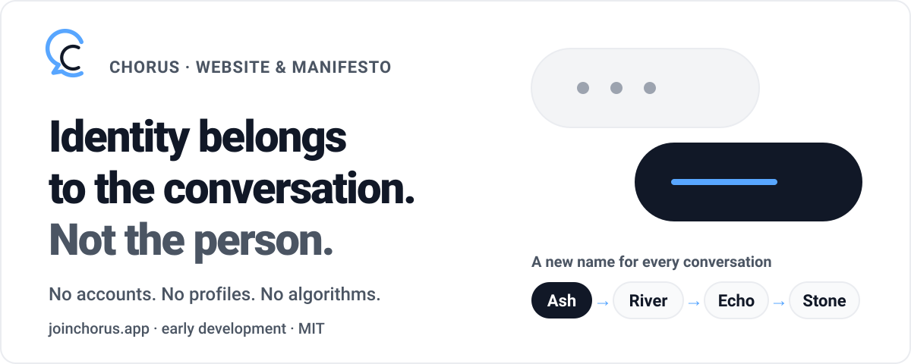
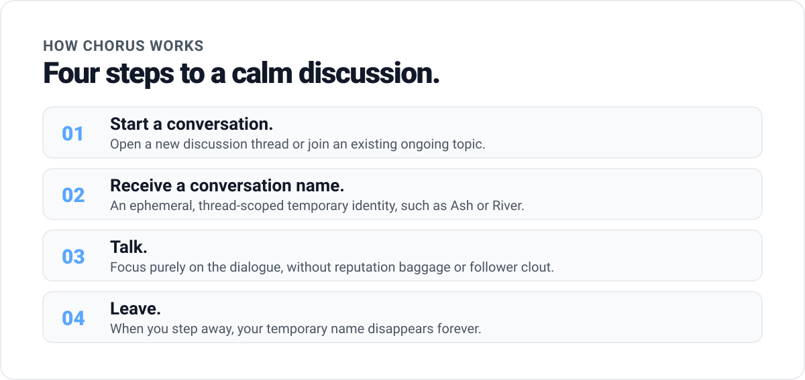

<p align="center">
  
</p>

<p align="center">
  <a href="https://github.com/joinchorus/website/actions/workflows/ci-cd.yml"></a>
  <a href="LICENSE"></a>
  <a href="https://joinchorus.app"></a>
</p>

**This is the source of [joinchorus.app](https://joinchorus.app)**, the one-page site and manifesto for [Chorus](https://github.com/joinchorus/chorus), an anonymous discussion platform where every conversation gives you a temporary name and nothing follows you out of it.

Chorus itself is in early development (v0.1.0-alpha). The site states the product's intent; it is not a claim that the product is finished.

## What the site says

One scrolling page, written as a manifesto. Its sections, in order:

1. **Hero:** "Identity belongs to the conversation. Not the person."
2. **The Problem:** platforms that care about who is speaking, not what is said.
3. **The Difference:** every conversation creates a new temporary name (Ash, River, Echo, Stone) that disappears when it ends.
4. **How Chorus Works:** four steps, below.
5. **Core Principles:** thread-scoped identity, no popularity metrics, privacy by design.
6. **Engineering:** discussions stored as native Git commits.

<p align="center">
  
</p>

## Run it locally

The site is plain HTML and CSS in `public/`, with no build step and no dependencies to install. You need Node.js for `npx serve`.

```bash
git clone https://github.com/joinchorus/website.git
cd website
npm run serve
```

`serve` listens on port 3000 by default and prints the address it chose. Edit `public/index.html` and reload.

## Repository layout

| Path | Contents |
| --- | --- |
| `public/index.html` | The whole page, with inline CSS, light and dark themes, and OpenGraph, Twitter and JSON-LD metadata |
| `public/logo.svg`, `public/favicon.svg` | Chorus speech-bubble C mark |
| `public/robots.txt`, `public/sitemap.xml` | Crawler files |
| `firebase.json` | Firebase Hosting config (site `chorus-website`) |
| `.github/workflows/ci-cd.yml` | Checks `public/index.html` exists, then deploys |
| `assets/readme/` | Images used by this README |

## Deployment

Pushes to `main` deploy to Firebase Hosting (project `chorus-chat-app`, target `chorus-website`) through [`ci-cd.yml`](.github/workflows/ci-cd.yml). Pull requests run the verify job only. `npm run build` is a placeholder that echoes a message.

## Related

| | |
| --- | --- |
| [joinchorus/chorus](https://github.com/joinchorus/chorus) | The application |
| [chat.joinchorus.app](https://chat.joinchorus.app) | Live app |
| [docs.joinchorus.app](https://docs.joinchorus.app) | Documentation |

## Contributing and security

See [CONTRIBUTING.md](CONTRIBUTING.md). To report a vulnerability, use [private vulnerability reporting](https://github.com/joinchorus/website/security/advisories/new) and read the organization's [security policy](https://github.com/joinchorus/.github/blob/main/SECURITY.md).

## License

[MIT](LICENSE)
